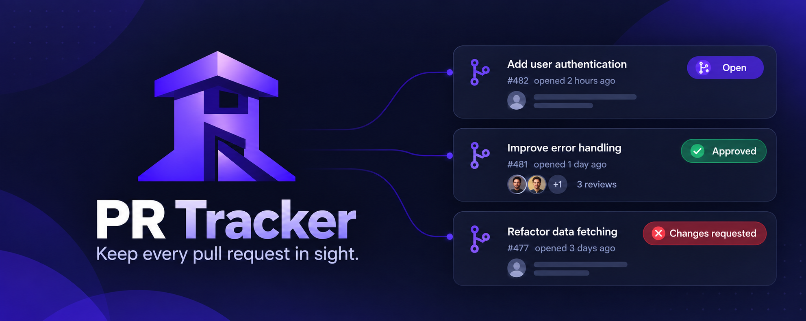
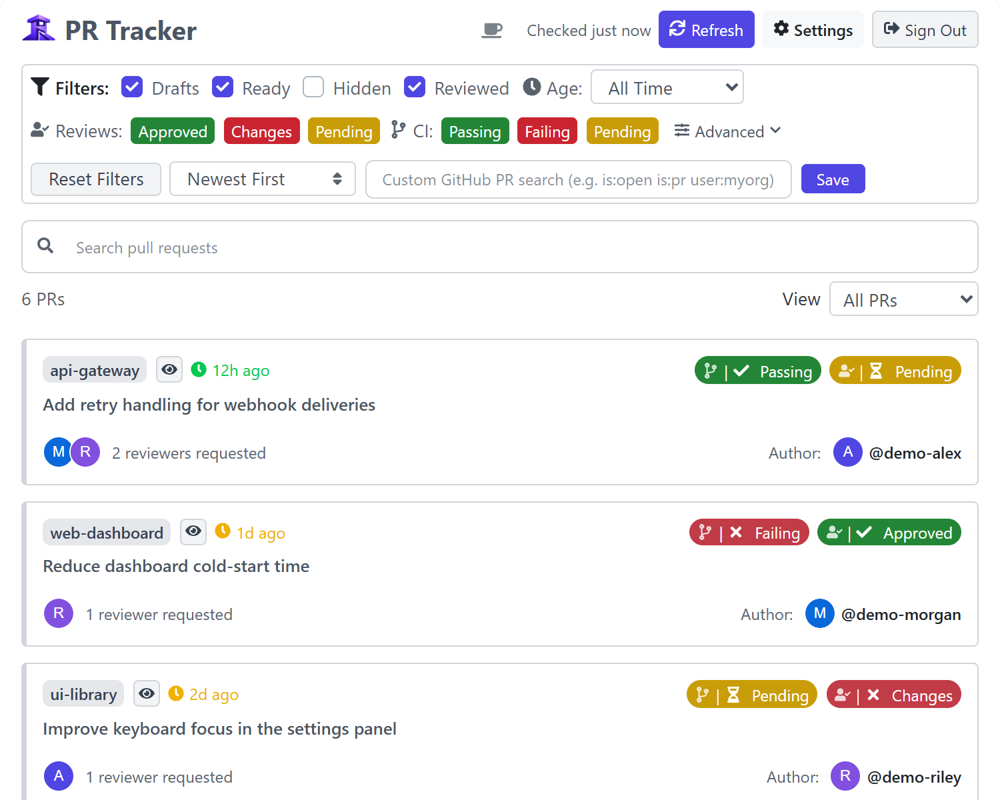
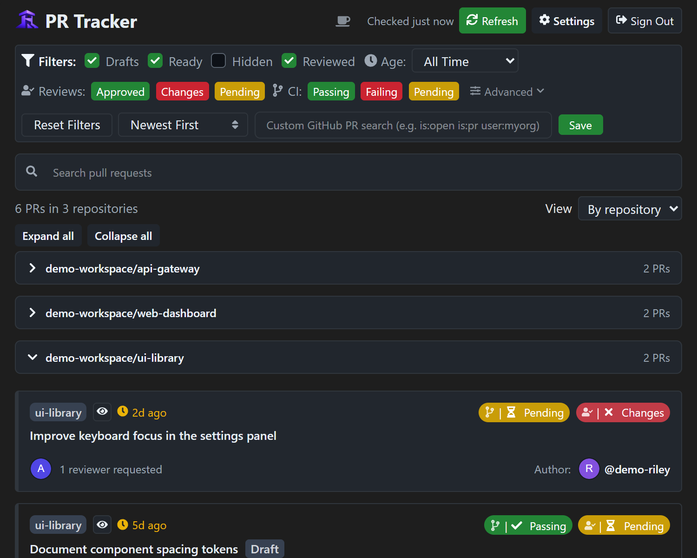

<p align="center">
  
</p>

<p align="center">
  <a href="https://chromewebstore.google.com/detail/pr-tracker/kfeglmkcicfmegclihokchplngcokgil"></a>
  <a href="https://addons.mozilla.org/en-US/firefox/addon/pr-tracker/"></a>
  <a href="https://github.com/aabiskar1/pr-tracker/actions/workflows/build.yml"></a>
  <a href="LICENSE"></a>
</p>

**PR Tracker** is a browser extension for Chrome and Firefox that brings your
GitHub pull requests and review requests into one compact popup. Check review
and CI status, find the PRs that need your attention, and see when GitHub was
last successfully checked.

## Install

- [Chrome Web Store](https://chromewebstore.google.com/detail/pr-tracker/kfeglmkcicfmegclihokchplngcokgil)
- [Firefox Add-ons](https://addons.mozilla.org/en-US/firefox/addon/pr-tracker/)

For a local build, follow the [development guide](docs/development.md).
This README describes the current source; store releases may lag behind it.

## Features

- **Track your work:** open PRs you authored, PRs requesting your review,
  and PRs you previously reviewed; or use a saved custom GitHub search query.
- **Choose your view:** keep the default **All PRs** list, or choose **By repository**
  for collapsible `owner/repo` groups. Expand or collapse individual repositories,
  or use Expand all and Collapse all. Your view and collapse choices are remembered.
- **Find what matters:** search titles and repository names; filter by age,
  draft/ready state, review status, and all five CI states, including **No CI**
  and **Unknown** under **Advanced**. Sort by newest, oldest,
  reviewer count, or staleness. Hide PRs and show them again when needed.
- **Stay informed:** reviewer avatars, draft/review/CI indicators, a toolbar
  count, and desktop notifications for newly discovered tracked PRs.
- **See the detail:** matching PR and repository counts, plus full-text tooltips
  on PR titles, repository badges and repository headings.
- **Keep data fresh:** manual Refresh, five-minute background checks while an
  unlocked session is available, and a persisted **Checked …** indicator.
- **Make it yours:** Auto / Light / Dark themes and notification preferences
  in Settings. Auto follows your system theme.
- **Unlock locally:** password-protected, encrypted token and app data, with
  an optional remembered session.

## Screenshots

These captures show the current extension with fictional demonstration data.

**All PRs** keeps detailed cards together, with review status, CI, author,
reviewers and age at a glance.



**By repository** makes longer lists easier to scan. Counts include matching
PRs inside collapsed groups. New repositories start expanded; your choices
survive closing the popup and restarting the browser, ready for the next unlock.



Search temporarily opens repositories containing matches. Clearing it restores
your collapse choices. Reset Filters leaves your view and collapse choices alone.

See [search and filtering](docs/assets/readme/search-light.png),
[Advanced CI filters](docs/assets/readme/advanced-light.png),
[All PRs in dark theme](docs/assets/readme/dashboard-dark.png), and
[Settings](docs/assets/readme/settings-dark.png).

## How it works

1. Open the extension and enter a
   [GitHub personal access token (classic) with `repo` scope](https://github.com/settings/tokens/new?scopes=repo&description=PR%20Tracker).
2. Create a password to encrypt your token and unlock stored data later.
   Optionally choose **Remember password for 12 hours**.
3. PR Tracker sends authenticated HTTPS requests directly to GitHub. By
   default it searches for your open authored PRs, review requests, and previously
   reviewed PRs. Saving a custom query replaces those default searches.
4. Use Refresh whenever needed. Background checks are scheduled every five
   minutes while an unlocked session is available, subject to browser scheduling
   and GitHub rate limits.

**Reviewed** is enabled by default, including after upgrading. It includes open
PRs reviewed by **you**, whether you approved, requested changes, or submitted
a comment-only review. It refers to your review history, independently of the
Approved / Changes / Pending aggregate status filters. Regular conversation
comments and unsubmitted draft reviews are not submitted reviews.

Reviewed PRs stay tracked through later commits and reviews until merged or
closed, then disappear on the next successful refresh. Uncheck Reviewed to
restore the original visible list of authored PRs and outstanding review
requests immediately from cached data. The checkbox is saved with your other
encrypted filters; Reset Filters enables it again. Historical reviewed-only
discoveries do not trigger new-PR notifications. Custom queries replace all
default searches and keep their existing semantics regardless of this checkbox.

**Checked …** represents the last successful GitHub refresh whose PR data was
saved to encrypted storage. Opening the popup, loading cached data, or a failed
refresh does not advance it. Hover over the status for the exact local time;
before the first successful check it shows **Not checked yet**.

PR Tracker operates no separate backend. See the
[architecture guide](docs/architecture.md) for the data flow and storage details.

## Privacy & Security

- Your PAT and cached app data, including PR data and account preferences,
  are encrypted in local extension storage using a key derived from your
  password. Theme preference and some non-sensitive metadata are stored separately.
- Your password is held in memory while unlocked. If you enable the remembered
  session, it is also stored in extension session storage with a 12-hour expiry;
  this is not permanent storage across browser restarts.
- Authenticated requests send your token and query data directly to GitHub
  over HTTPS. Reviewer and author avatars may load from remote image URLs.
- **Sign Out** locks the session and retains encrypted account data for the
  next password unlock. If you forget your password, use **Full Reset** on the
  unlock screen to remove account data and start again. Theme preference is retained.

Read the [privacy policy](https://aabiskar1.github.io/pr-tracker/privacy.html)
([repository source](docs/privacy.html)).

## Development

Use Node.js 24 LTS and npm with the committed lockfile. Start with:

```sh
npm ci
npm run dev
```

- [Development guide](docs/development.md): setup, local loading, and Chrome/Firefox builds.
- [Testing guide](docs/testing.md): deterministic unit/E2E workflows and browser coverage.
- [Architecture guide](docs/architecture.md): popup, background checks, storage, and notifications.
- [Screenshot guide](docs/screenshots.md): repeatable demonstration captures and draft store assets.

## Contributing

Report bugs or suggest improvements through
[GitHub issues](https://github.com/aabiskar1/pr-tracker/issues).
For a code contribution, work on a dedicated branch, keep changes focused,
and include relevant tests and validation in your pull request. Follow the
[engineering guidance](AGENTS.md) and development guide.

## CI states and filters

PR Tracker distinguishes `passing` (green), `failing` (red), `pending` (yellow),
`no-ci` (no badge or placeholder), and `unknown` (a neutral Unknown badge).
No CI means GitHub confirmed no checks or commit-status contexts. Unknown means
CI could not be determined reliably; its tooltip explains this distinction.

Use the Passing, Failing and Pending filters directly, and open **Advanced** for
No CI and Unknown. All five states can be filtered independently. Defaults and
Reset Filters include all five; clearing every CI selection also includes all
states. Cached Pending results stay Pending until refreshed.

The Approved, Changes and Pending review filters describe a PR's aggregate
review status. **Reviewed** separately controls whether PRs you previously
reviewed are included, as explained above.

## License

[MIT](LICENSE).
