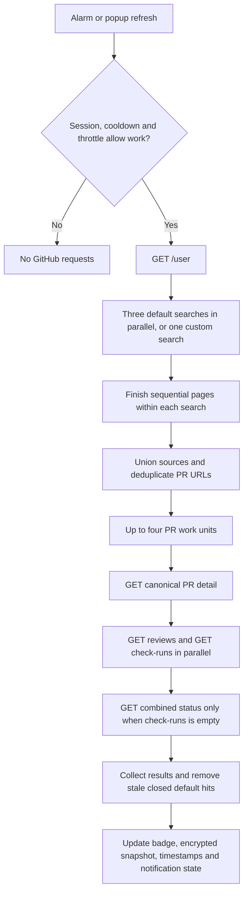

# GitHub GraphQL migration investigation

Investigated against `origin/main` at `8a255e1` on 2026-10-31.

## Recommendation

The acceptance criterion is a meaningful improvement in API efficiency and
refresh performance **without changing existing user-facing behaviour**.
The investigation does not yet establish that result. Retain the production
REST fetcher. GraphQL has promising request-count savings, but the compact
experiment fails behaviour equivalence and no live performance improvement has
been measured. Its 303-to-6 fixture comparison is not evidence for a suitable
replacement under this criterion.

A hybrid using GraphQL for discovery/required metadata and the existing REST
review/CI operations is the most plausible next candidate. Its estimated savings
are smaller, and parity, error handling and performance must be demonstrated
before recommending adoption. Adopting different review/CI summaries is outside
this investigation's goal.

This PR contains an isolated, browser-independent proof of concept in
[`src/experiments/githubGraphql/client.ts`](../src/experiments/githubGraphql/client.ts).
No production entrypoint imports it. It uses native `fetch` through a required
injected transport and the existing Zod dependency. There are no dependency,
permission, storage, authentication, UI, polling, or release changes.

## Current REST behaviour

Source inspection, including a codebase-memory call trace, establishes:

- [`prManager.ts`](../src/background/prManager.ts) checks the persisted cooldown,
  decrypts the token, and fetches `/user` before calling `fetchPullRequests`.
  Successful results update the badge, encrypted snapshot, timestamps and
  notification comparison state. Required failures preserve the cached snapshot.
- [`api.ts`](../src/background/api.ts) searches authored, review-requested, **and
  reviewed-by** open PRs, or uses one custom query verbatim. Each search requests
  100 items per page, up to 1,000 per search. It rejects incomplete/unusable pages.
  Default discovery sources are unioned and duplicate PRs fetched only once.
- Canonical REST PR details are required. Four PR work units run concurrently;
  reviews and checks run concurrently within a work unit. The current design
  therefore bounds that phase at eight simultaneous supporting requests.
- Review status uses the last returned review per numeric user ID. Any remaining
  change request wins over approval; otherwise status is pending. Reviews are
  fetched with the endpoint's default pagination, not an exhaustive history.
- CI uses check runs: failure/timed-out means failing, all completed/success
  means passing, otherwise pending. Combined commit status is requested only
  when there are no check runs. Neither supporting endpoint paginates today.
- Optional failures degrade to pending. Recognized optional cooldowns propagate
  to the manager while the complete PR snapshot can still succeed. Required
  failures prevent a successful snapshot; a required rate limit also stops
  scheduling additional PR work units.

The graph reported changed file metadata; material conclusions above were checked
against the current source rather than relying on index freshness.

### Request sequence and endpoint costs



This diagram shows the successful request path. A required user/search/detail
failure exits before successful snapshot effects; optional review/CI failures
can reach the final step with pending status and a propagated cooldown.

| Phase              | Endpoint                                             | Calls in a successful refresh | Dependency / response use                                                                                   |
| ------------------ | ---------------------------------------------------- | ----------------------------: | ----------------------------------------------------------------------------------------------------------- |
| Identity           | `GET /user`                                          |                             1 | Login supplies default search qualifiers. Runs even for custom queries. Required.                           |
| Discovery          | `GET /search/issues?q=...&per_page=100&page=...`     |                           `S` | Three default queries or one custom query; sequential pagination per query, up to ten pages each. Required. |
| Canonical metadata | `GET /repos/{owner}/{repo}/pulls/{number}`           |                           `N` | Author, reviewers, current state, repository and head SHA. Required before supporting requests.             |
| Reviews            | `GET /repos/{owner}/{repo}/pulls/{number}/reviews`   |                           `N` | Existing latest-per-user reduction over the returned default page. Optional.                                |
| Checks             | `GET /repos/{owner}/{repo}/commits/{sha}/check-runs` |             `C`, normally `N` | Skipped if usable repository/head-SHA context is absent. Optional.                                          |
| Legacy CI fallback | `GET /repos/{owner}/{repo}/commits/{sha}/status`     |            `F`, from 0 to `C` | Runs only after a successful empty check-runs response, not after a check-runs error. Optional.             |

Here `N` counts distinct canonical PRs hydrated, **before** stale closed/merged
default hits are removed. Using only the final visible count can understate
cost. Deduplication across default searches avoids repeated detail/supporting
requests, but each search still pays for all its own result pages. An empty
search costs one request. With capped per-query counts `R_i`:

```text
S = sum(max(1, ceil(R_i / 100)))
core requests = 1 + 2N + C + F
total requests = S + 1 + 2N + C + F
usual valid-CI-context case (C = N): total = 1 + S + 3N + F
```

The following are **full-refresh estimates**, derived from the source flow;
the later fixture table measures only the fetcher boundary, excluding `/user`.
Default examples assume each of the three searches returns the same `N` PRs,
and all PRs have valid CI context. Custom examples use one query.

| Hydrated PRs | Default search calls | Core calls, checks / universal fallback | Default total, checks / fallback | Custom total, checks / fallback |
| -----------: | -------------------: | --------------------------------------: | -------------------------------: | ------------------------------: |
|            0 |                    3 |                                   1 / 1 |                            4 / 4 |                           2 / 2 |
|            1 |                    3 |                                   4 / 5 |                            7 / 8 |                           5 / 6 |
|           10 |                    3 |                                 31 / 41 |                          34 / 44 |                         32 / 42 |
|           50 |                    3 |                               151 / 201 |                        154 / 204 |                       152 / 202 |
|          100 |                    3 |                               301 / 401 |                        304 / 404 |                       302 / 402 |
|        1,000 |                   30 |                           3,001 / 4,001 |                    3,031 / 4,031 |                   3,011 / 4,011 |

Search and core requests consume separate REST primary rate-limit resources;
adding them describes HTTP volume, not a single shared primary budget. See
[GitHub's rate-limit resource definitions](https://docs.github.com/en/rest/rate-limit/rate-limit).
The configured five-minute alarm/automatic-refresh interval implies about twelve
eligible refreshes per hour. At 100 PRs this models **3,612 core + 36 search**
requests per hour normally, or **4,812 core + 36 search** with universal fallback.
These estimates assume continuous eligibility, no failures/cooldowns and no
manual refreshes; they are not observed account consumption.

### Scheduling, avoided work and performance limits

- A locked/missing session, active persisted cooldown, automatic refresh interval
  or manual throttle can stop work before `/user`. Concurrent refresh requests
  in the same session share one in-flight operation. Normal automatic refreshes
  use a five-minute interval; manual refreshes have a four-second throttle.
- Discovery has at most three requests in flight by default, or one for a custom
  query. All searches settle before detail work starts; failure of one default
  search does not cancel its siblings. The page cap is per search, so three
  default queries can hydrate up to 3,000 disjoint PRs.
- Each of four workers retains its slot through detail, review/check and optional
  fallback completion. Detail must finish before supporting calls start; reviews
  and checks overlap, and fallback status waits for checks. The detail phase
  therefore has at most eight GitHub requests in flight, not an unbounded `2N`.
- There are no immediate request retries in this path. A required rate-limit
  result stops new queued PR work after its worker result is collected; already
  active work settles. Optional failures can still finish a successful refresh
  and persist the latest cooldown for subsequent refresh suppression.
- The fetcher does not explicitly send conditional-request validators or reuse
  cached PR metadata to omit per-PR requests. Encrypted cached data preserves the
  UI across failures but is not an incremental API cache. Browser/network caching
  effects were not measured.
- Token onboarding independently calls `/user` from `useAuth` to validate the
  classic token's `repo` scope. That request is outside these refresh counts.

The main scaling cost is the per-PR `3N` (or `4N`) fan-out, including unchanged
PRs. Concurrency limits reduce burst pressure but do not reduce call count.
Wall time also includes token/storage work, JSON parsing, mapping, encryption and
notification handling; these costs, response sizes and live endpoint latencies
have not been profiled. A request-count reduction alone cannot quantify refresh
speed. An incremental REST-cache alternative also deserves comparison before
attributing all potential improvement to GraphQL; GitHub documents
[authenticated conditional requests](https://docs.github.com/en/rest/using-the-rest-api/best-practices-for-using-the-rest-api#use-conditional-requests).

## Field and behaviour mapping

| Existing domain field or behaviour           | GraphQL candidate                                         | Assessment                                                                                                                                                        |
| -------------------------------------------- | --------------------------------------------------------- | ----------------------------------------------------------------------------------------------------------------------------------------------------------------- |
| Numeric `id`                                 | `PullRequest.fullDatabaseId`                              | Preserve REST numeric identity for hidden IDs and notification history. Reject null/unsafe integers; do not substitute opaque node `id` or PR `number`.           |
| Title, link, repository, draft, created date | `title`, `url`, `repository.name`, `isDraft`, `createdAt` | Direct mapping.                                                                                                                                                   |
| Open/closed state                            | `state`                                                   | Map MERGED and CLOSED to REST `closed`; exclude these from default searches, retain in custom searches. Search-index freshness still needs evaluation.            |
| Author                                       | `author { login avatarUrl }`                              | Nullable actor; map a missing author to undefined.                                                                                                                |
| Requested reviewers                          | `reviewRequests.nodes.requestedReviewer`                  | Union of user-like actors and teams. Map User/Bot/Mannequin; omit Team/EnterpriseTeam to match the domain's individual-reviewer field. Reject null/unknown types. |
| Discovery sources                            | Three separate search strings                             | Retain exact current qualifiers and source union. Custom search has no discovery-source annotations.                                                              |
| Review label                                 | `reviewDecision`                                          | Compact alternative, **not equivalent** to current latest-review-per-user calculation. Null/REVIEW_REQUIRED maps to pending.                                      |
| CI label                                     | `statusCheckRollup.state`                                 | Compact alternative combining checks and statuses; current REST prefers check runs and ignores statuses whenever checks exist.                                    |
| API budgets                                  | HTTP headers and `rateLimit { cost remaining resetAt }`   | Preserve telemetry; real cost must be observed. GraphQL errors may accompany HTTP 200.                                                                            |

GitHub documents the [PR fields and reviewer unions](https://docs.github.com/en/graphql/reference/pulls)
and the [combined check/status rollup](https://docs.github.com/en/graphql/reference/commits#statuscheckrollup).
`fullDatabaseId` replaces the deprecated `databaseId`. Numeric IDs beyond
`Number.MAX_SAFE_INTEGER` require a separate domain/storage migration, not a
lossy conversion in this experiment.

Two explicit semantic counterexamples are encoded in tests:

- One review is approved, but the aggregate decision remains REVIEW_REQUIRED
  (for example, further approvals are required): REST shows approved; the
  summary experiment shows pending.
- Check runs pass while a legacy commit status fails: REST shows passing;
  a failing combined rollup maps to failing.

These synthetic examples demonstrate a mapping difference, not evidence that
GitHub produced these responses for a particular live repository. Cancelled,
neutral, skipped and action-required checks, dismissed reviews, branch protection
and stale approvals need broader semantic fixtures before choosing a replacement.
For compatibility, prefer retaining the existing REST review/check/status
operations in a hybrid experiment. A full GraphQL replacement would need to
reproduce their current ordering, default-page selection, check-run precedence,
optional-failure degradation and cooldown behaviour, as well as the reducers.
Fetching a more complete history can itself change the displayed result and
does not prove parity. Nested pagination increases requests and complexity and
needs its own measurements.

### Behaviour-preservation assessment

| Area                                                     | Current experiment                                                                 | Acceptance status                           |
| -------------------------------------------------------- | ---------------------------------------------------------------------------------- | ------------------------------------------- |
| Successful common metadata and discovery-source union    | Matching synthetic fixtures produce equal domain arrays                            | Demonstrated only for the supplied fixtures |
| Review and CI labels                                     | Counterexample produces different labels                                           | Fails equivalence                           |
| Optional field failures                                  | Any GraphQL error rejects the entire refresh; REST can succeed with pending status | Fails equivalence                           |
| Nullable/partial metadata and reviewer connections       | Experiment validates more strictly than REST and rejects truncated nested data     | Failure-path parity unproven                |
| Search syntax, selection, ordering and freshness         | Query strings preserved; no live comparison                                        | Unproven                                    |
| Hidden state, notifications, cache, badge and timestamps | Numeric identity mapping tested; experiment is not wired to manager                | Integration parity unproven                 |
| Refresh performance and rate-budget consumption          | No live timings or costs                                                           | Unproven                                    |

These gaps make the compact experiment unsuitable for a production switch.
Rejecting partial data protects cached data, but does not by itself preserve
REST's successful-refresh and optional-error behaviour.

## Proof-of-concept boundaries

- Sequential search requests, 50 PRs per page, 1,000 results per search. Custom
  query text is sent as a variable without rewriting it. Mixed Issue/PR searches
  fail explicitly instead of silently dropping Issue nodes.
- At most 100 review requests per PR. If a nested connection has another page,
  the experiment rejects the refresh; it does not claim complete reviewer data.
  A production version needs nested pagination or an approved fallback policy.
- Malformed data, null nodes, missing/unsafe identities, duplicate results within
  a search, repeated/missing cursors, premature termination, HTTP errors and
  GraphQL errors reject the operation. No partial list is returned on failure.
- A 1,000-result search cap is explicit through `truncated`, unlike a claim of
  complete discovery beyond that ceiling. A production caller must decide how
  to expose this limitation. Changing search contents between pages cannot be
  fully detected by count/cursor checks.
- Any nonempty GraphQL `errors` rejects even HTTP 200 responses containing data.
  The error retains the original Response (including headers and unread body).
  There are no automatic retries, waits, logging of tokens, browser side effects
  or storage writes. Cancellation is checked around asynchronous boundaries.
- Successful responses return per-page rate-limit telemetry, which is synthetic
  in these tests. This is not a production cooldown implementation. In particular,
  passing an HTTP 200 GraphQL error to the existing HTTP-only classifier is
  insufficient; integration needs a GraphQL-aware error adapter.

GitHub supports [search syntax and cursor pagination with a 1,000-result ceiling](https://docs.github.com/en/graphql/reference/search).
Search-index behaviour and REST/GraphQL custom-query compatibility have not been
verified against live data. Fixture tests validate the client contract, not the
remote schema or query execution.

## Measured results: deterministic fixtures

Reproduce with:

```sh
npx vitest run tests/unit/graphql-investigation.unit.test.ts
```

The tests execute the **existing REST fetcher** and the experimental GraphQL
client with fixed synthetic responses, count actual mocked transport invocations,
and assert equality of the mapped PR arrays for matching summary states. All
three default searches deliberately return the same PRs to test deduplication
and source union. REST search uses one page per search in these cases; GraphQL
uses pages of 50. These measurements exclude the manager's `/user` request and
token setup. They do not measure network performance.

| Unique PRs | REST default, passing checks | GraphQL default | REST default, no checks/status fallback | REST custom, passing checks | GraphQL custom |
| ---------: | ---------------------------: | --------------: | --------------------------------------: | --------------------------: | -------------: |
|          1 |                            6 |               3 |                                       7 |                           4 |              1 |
|         10 |                           33 |               3 |                                      43 |                          31 |              1 |
|         50 |                          153 |               3 |                                     203 |                         151 |              1 |
|        100 |                          303 |               6 |                                     403 |                         301 |              2 |

The fallback scenario produces the same mapped arrays and GraphQL call counts
as the passing-check scenario. A separate synthetic 1,200-match custom search
returns 1,000 mapped PRs, marks truncation, and stops after 20 calls. Error,
pagination, nullable-field, status-mapping and cancellation scenarios also run
without live credentials. The investigation suite has 48 tests.

No live GitHub timing, payload size, memory, CPU, primary point cost or actual
rate-limit reduction was measured. The fixture `cost: 1` only tests telemetry
plumbing and must not be used as a cost estimate. Production bundle isolation is
checked with both browser builds and a search for the experimental query name
in their output.

## Estimates and unverified expectations

Let `N` be unique PRs and `R_i` the raw result count of search `i`, capped at
1,000. REST total refresh calls are approximately:

```text
S = sum(max(1, ceil(R_i / 100)))
normal:   1 + S + 3N
fallback: 1 + S + 4N
```

The leading 1 is the background `/user` request. The compact GraphQL experiment,
if integrated while retaining that identity request, would use:

```text
1 + sum(max(1, ceil(R_i / 50)))
```

For the 100-PR overlapping-default fixture, full refresh counts would therefore
be 304/404 REST calls versus 7 GraphQL calls. These are extrapolations from the
fixture boundary, not full-manager measurements. At 1,000 results in each of
three fully overlapping searches, the model gives 3,031/4,031 REST calls versus
61 GraphQL calls. Disjoint results, overlap, nested continuations, retries,
hybrid REST support and query page-size tuning change these numbers.

Fewer HTTP calls plausibly reduce fan-out overhead, but do not establish faster
refreshes or proportionate rate-budget savings. GraphQL has a distinct primary
point budget, shared secondary constraints, a node cap and timeout/resource
limits. A page of 50 PRs with up to 100 nested reviewer requests selects roughly
5,050 connection nodes, below the documented 500,000-node ceiling; this is a
shape estimate, not server-cost evidence. See GitHub's
[rate and query limits](https://docs.github.com/en/graphql/overview/rate-limits-and-query-limits-for-the-graphql-api).

### Behaviour-preserving hybrid estimate

Retaining REST review and CI requests while replacing search and canonical
metadata with GraphQL changes the estimate to:

```text
G = sum(max(1, ceil(R_i / 50)))
normal hybrid:   1 + G + 2N
fallback hybrid: 1 + G + 3N
```

For 100 PRs overlapping all three default searches, this is **207 versus 304**
calls normally (about 32% fewer), or **307 versus 404** with universal combined
status fallback (about 24% fewer). These are estimates, not measurements of an
implemented hybrid. They assume one GraphQL metadata page per 50 results,
complete reviewer metadata and no extra hydration/fallback requests. The hybrid
query would also need `headRefOid` and repository identity to address the existing
CI endpoints; the compact query has not implemented that path.

Keeping REST canonical details as well as REST supporting calls would instead
use `1 + G + 3N` normally: 307 calls in this case, exceeding the 304-call baseline.
Replacing discovery alone therefore has no demonstrated efficiency benefit.

Request count also misses the critical path. The baseline performs its three
searches concurrently, then bounds detail/status work to four PRs. The experiment
serializes all GraphQL pages. In a simplified model where every request takes
the same time L, all statuses need one request, and PRs finish in groups of four,
the 100-PR baseline takes roughly `L + 25 * (L + L) = 51L` after identity lookup;
the proposed hybrid takes `6L + 25L = 31L`. For one PR the same assumptions give
`3L` for REST versus `4L` for the hybrid. These are scheduling estimates, not
timing measurements; heavier GraphQL queries, network variability, processing
cost and actual worker overlap can change or reverse the outcome.

A performance comparison should measure equivalent successful and failed
refreshes at 0, 1, 10, 50, 100 and paginated result counts, including overlap,
fallback statuses and partial failures. Report end-to-end median/tail latency,
requests by API resource, response bytes and observed GraphQL cost separately.
Use deterministic fixtures to prove output/error/side-effect parity; do not
present synthetic delays or local Vitest duration as evidence of GitHub speed.

## Migration gates and suggested follow-up

1. Preserve current review/CI semantics. Build a separate hybrid comparison that
   retains the existing supporting REST operations and tests matching outputs
   and optional-error outcomes, including large connections and inaccessible
   PRs. Full-GraphQL alternatives must meet the same parity requirement; adopting
   aggregate summaries does not satisfy this goal.
2. Validate the query against the current GitHub schema and optionally run a
   manually opted-in comparison on representative repositories. Record real
   costs/headers, response bytes, wall time, failures and semantic mismatches
   separately from fixture measurements. Keep automated CI credential-free.
3. Keep classic-PAT `repo` validation in `useAuth` for the initial integration.
   GraphQL uses the same API host and accepts PAT authentication; adding
   fine-grained token support is a separate onboarding/permissions change.
   Public/private access, org SSO and field permissions still need validation.
   See [GitHub authentication guidance](https://docs.github.com/en/graphql/guides/forming-calls-with-graphql).
4. Add a small GraphQL transport/error adapter behind the current fetch-result
   boundary, preserving HTTP 200 rate-limit metadata and the existing persisted
   cooldown, session-generation checks and abort signal. Reject failed discovery
   before badge/storage/timestamp/notification effects. Do not fall back blindly
   to REST after a rate limit or permission failure.
5. Retain the client-only Chrome MV3/Firefox MV2 architecture, numeric identity,
   encrypted state and current discovery/filtering behaviour. No GraphQL SDK,
   cache framework, backend, new host permission or code generator is needed.
   Add manager integration and deterministic Chrome E2E coverage only when the
   production path is wired, plus both browser builds and Firefox runtime
   validation where available.

## Validation

- Before changes: unit suite passed, 24 files / 377 tests.
- After changes: compilation, lint and unit suite passed, 25 files / 425 tests.
- Changed-file Prettier checks passed. `npm run check-format` reported 122
  existing file issues, including unrelated local artifacts; none were the four
  files introduced by this investigation. Unrelated files were left unchanged.
- `npm run build:all` passed for Chrome and Firefox after rerunning outside the
  Windows sandbox (`spawn EPERM` on the initial attempt). Build output retained
  dependency annotation and Firefox data-collection warnings. No experimental
  query/error marker was present in either production output; source search
  found the query only in the experimental module.
- E2E is not required for this unconnected experiment: production user workflows
  are unchanged. No live GitHub PR-data requests or credentials are used by tests.
